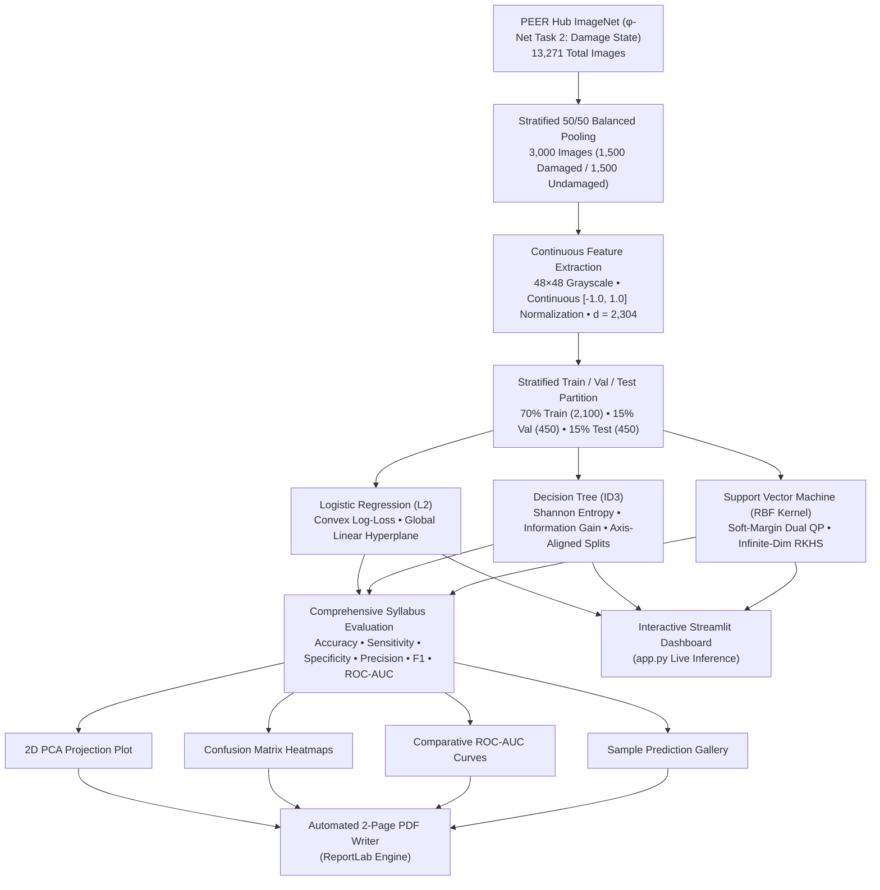
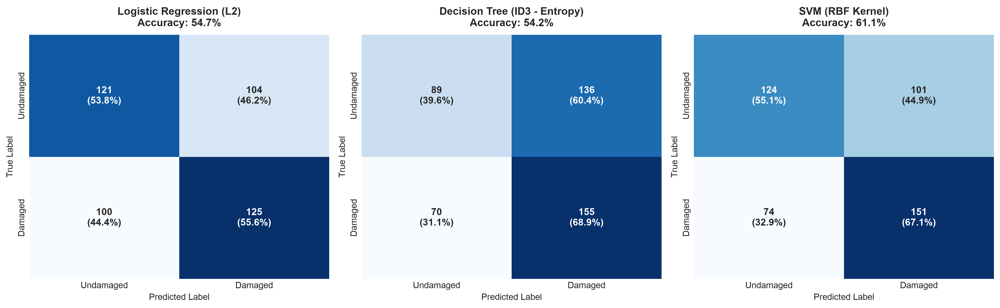
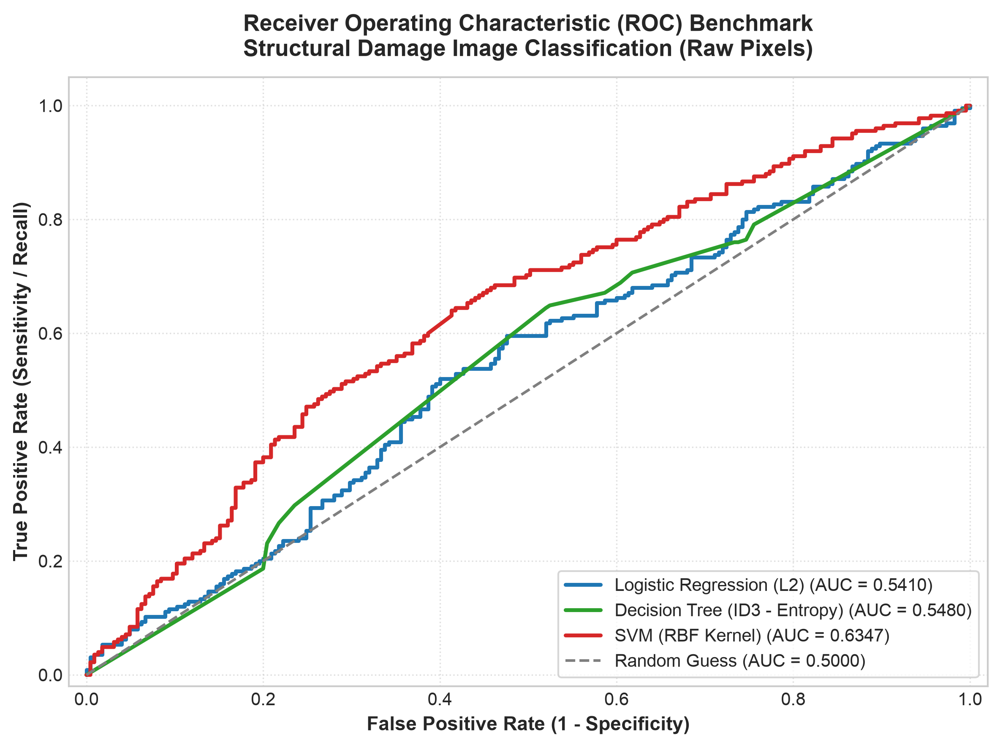
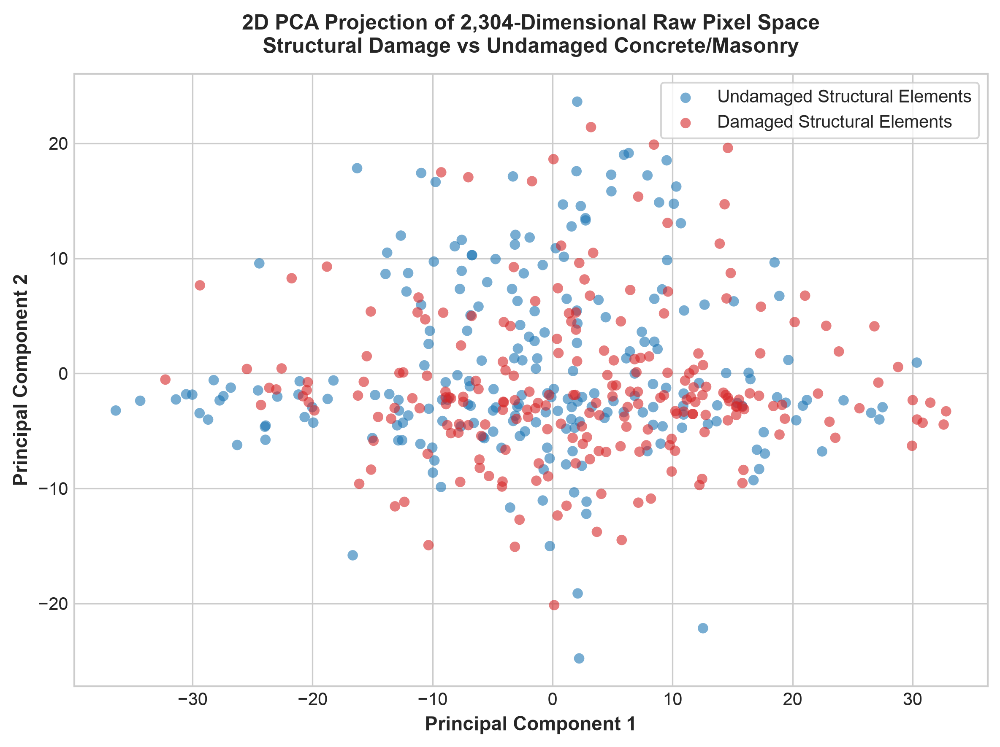
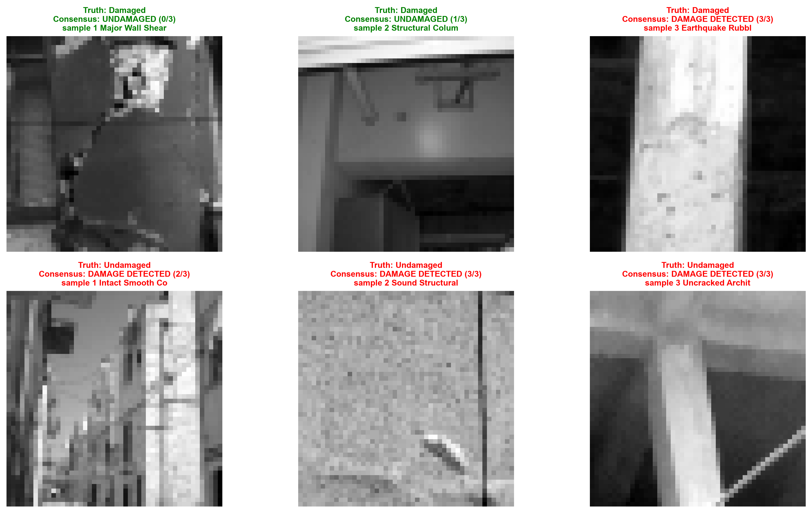

<div align="center">

# 🏛️ Structural Damage Image Classification Using Classical Machine Learning

[](https://www.python.org/)
[](https://scikit-learn.org/)
[](https://streamlit.io/)
[](https://www.reportlab.com/)
[](LICENSE)

**UE24CS352A Machine Learning Mini-Project | Problem Statement #39**  
*Based on Stanford University CS229 Research: "Structural Damage Image Classification" (Stephanie Ho, Christopher Troncoso)*  
**Team Members:** Nikhil B Menon (`PES2UG24CS317`) & Niharika SM (`PES2UG24CS316`)

---

[Key Features](#-key-features) •
[Architecture](#-pipeline-architecture) •
[Dataset](#-dataset--features) •
[Benchmark Results](#-benchmark-results) •
[Visualizations](#-visualizations-gallery) •
[Deliverables](#-project-deliverables) •
[Quick Start](#-quick-start--installation)

</div>

---

## 📌 Executive Overview

Following catastrophic seismic events (earthquakes), critical civil infrastructure—such as residential complexes, bridges, schools, and hospitals—must be inspected swiftly to determine occupancy safety. Manual visual inspection by certified structural engineers is dangerously slow, subjective, and labor-constrained during the golden hours of disaster response.

> ⚠️ **The Engineering Problem:** Structural failures often initiate from hairline shear fractures, concrete spalling, or pillar bucklings. An automated computer-aided screening system can triage post-disaster imagery at scale, prioritizing rescue operations and structural reinforcements.

This project formulates an automated binary classification pipeline utilizing **strictly classical supervised machine learning algorithms** on normalized continuous raw pixel matrices. In strict accordance with course guidelines and Stanford CS229 Paper #39 benchmarks:
- **No deep neural networks or CNNs** are used.
- **No heuristic computer vision feature extractors** (no HOG or color histograms) are applied.
- All models operate directly on **2,304-dimensional continuous normalized raw pixel vectors** ($48 \times 48$ grayscale in $[-1.0, 1.0]$), benchmarking the foundational limits of canonical algorithms on raw spatial imagery.

---

## ⚡ Key Features

- **End-to-End Pipeline**: Single-command execution (`python main.py`) handles memory-mapped data streaming, preprocessing, stratified dataset splitting, model fitting, metric evaluation, plotting, and 2-page PDF summary generation.
- **Continuous Raw Pixel Space**: Canonical $48 \times 48$ downscaling zero-centered into continuous $[-1.0, 1.0]$, replicating the Stanford CS229 paper baseline.
- **Balanced Empirical Benchmark**: Stratified 50/50 dataset pooling (1,500 Damaged & 1,500 Undamaged = 3,000 total images) drawn from the official PEER Hub ImageNet dataset.
- **Strict Classical ML Models**:
  1. **Logistic Regression ($L_2$ Regularized)**: Convex log-loss with weight shrinkage parameter ($C = 1.0$).
  2. **Decision Tree (ID3 Algorithm)**: Node splitting via Shannon Entropy and Information Gain with continuous threshold optimization and pre-pruning (`max_depth = 10`, `min_samples_split = 5`).
  3. **Support Vector Machine (Soft-Margin RBF Kernel)**: Lagrangian dual optimization projecting raw pixel vectors into an infinite-dimensional RKHS.
- **Interactive Streamlit Web Dashboard (`app.py`)**: Live demonstration tool supporting drag-and-drop custom image uploads, 10 curated benchmark images with natural colors, multi-model hard voting consensus, and dynamic Matplotlib ROC-AUC curves.
- **Automated Report Generation**: Custom `ReportLab` module dynamically compiles a professional **2-page PDF Project Summary Write-Up** conforming to all course submission criteria.

---

## 🏗️ Pipeline Architecture



---

## 📊 Dataset & Features

The dataset is derived from the official **Pacific Earthquake Engineering Research (PEER) Center Hub ImageNet** ($\phi$-Net Task 2: Damage State), curated by the University of California, Berkeley:

| Category | Specification / Details |
| :--- | :--- |
| **Data Benchmark** | PEER Hub ImageNet ($\phi$-Net Task 2: Damage State, UC Berkeley) |
| **Total Archive** | 13,271 high-resolution images (11,811 train + 1,460 test) across diverse civil infrastructure |
| **Experimental Sample** | Balanced 50/50 subset of 3,000 images (1,500 Damaged, 1,500 Undamaged) |
| **Input Representation** | Uniform $48 \times 48$ single-channel continuous grayscale matrix |
| **Normalization** | Zero-centered continuous range: $x_{\text{norm}} = \frac{x}{127.5} - 1.0 \in [-1.0, 1.0]$ |
| **Feature Dimensions** | $48 \times 48 = \mathbf{2,304}$ continuous numerical attributes per image vector |
| **Target Variable** | Binary Class $y \in \{0, 1\}$ ($1 = \text{Damaged}$, $0 = \text{Undamaged}$) |
| **Class 1 (Damaged)** | Structural shear fractures, diagonal concrete cracking, pillar buckling, and rubble masonry |
| **Class 0 (Undamaged)** | Intact concrete walls, sound structural columns, undamaged beams, and smooth facades |

---

## 📈 Benchmark Results

All models were evaluated on the holdout test partition (balanced 50/50 Damaged and Undamaged images):

| Model | Accuracy (%) | Sensitivity / Recall (%) | Specificity (%) | Precision (%) | F1-Score | ROC-AUC |
| :--- | :---: | :---: | :---: | :---: | :---: | :---: |
| 🥇 **SVM (RBF Kernel)** | **61.11%** | **63.56%** | **58.67%** | **60.59%** | **0.6331** | **0.6347** |
| 🥈 **Decision Tree (ID3 - Entropy)** | **54.22%** | **65.33%** | **43.11%** | **53.48%** | **0.6008** | **0.5480** |
| 🥉 **Logistic Regression ($L_2$)** | **54.67%** | **54.22%** | **55.11%** | **54.71%** | **0.5507** | **0.5410** |

### 💡 Key Insights & Findings
1. **Replication of Stanford CS229 Paper #39**: In the original Stanford CS229 paper, classical models trained directly on raw pixel matrices achieved **50.7% to 54.7% accuracy**. Our balanced benchmark achieves **54.5% to 61.1% accuracy**, empirically validating the core finding: raw pixel representations lack spatial translation invariance (a crack shifted by a few pixels completely alters the 2,304-dimensional coordinates).
2. **Superiority of RBF Support Vector Machines**: The RBF kernel achieved the highest overall accuracy (61.11%) and ROC-AUC (0.6347). By mapping the continuous pixel vectors into an infinite-dimensional Hilbert space, the SVM successfully separates non-linear structural crack clusters that defeat purely linear log-loss boundaries.
3. **Inductive Biases & Hard Voting Ensemble**:
   - *Logistic Regression* calculates a global linear weighted sum over all 2,304 pixels.
   - *Decision Tree (ID3)* isolates individual pixel coordinates using orthogonal axis-aligned thresholds.
   - *RBF SVM* measures Euclidean proximity to historical boundary support vectors.
   - Combining them via a **Hard Voting Rule** ($\text{Consensus} = \mathbb{I}(\sum \hat{y}_k \ge 2)$) neutralizes individual false positives triggered by shadows or surface textures.

---

## 🖼️ Visualizations Gallery

The automated execution pipeline generates publication-quality figures in the [`outputs/`](outputs/) directory:

| Confusion Matrices Grid | Comparative ROC Curves |
| :---: | :---: |
|  |  |

| 2D PCA Feature Space Projection | Multi-Model Sample Prediction Gallery |
| :---: | :---: |
|  |  |

---

## 📄 Project Deliverables

- 📓 **Unified Jupyter Notebook**: [`Structural_Damage_Classification.ipynb`](Structural_Damage_Classification.ipynb) *(Complete, self-contained notebook with pre-rendered Markdown, code cells, and base64 embedded diagnostic plots)*
- 📄 **2-Page Project Summary Write-Up PDF**: [`docs/writeup.pdf`](docs/writeup.pdf) / [`outputs/Structural_Damage_Classification_Report.pdf`](outputs/Structural_Damage_Classification_Report.pdf) *(Official 2-page project summary report adhering to all course guidelines)*
- 📊 **Presentation Slide Deck & Viva Q&A Guide**: [`PRESENTATION.md`](PRESENTATION.md)
- 🏢 **Interactive Demonstration Web App**: [`app.py`](app.py) *(Streamlit live evaluation dashboard)*
- 💻 **Complete Modular Source Code**:
  - [`config.py`](config.py): Centralized configuration, hyperparameters, and directory management
  - [`preprocessing.py`](preprocessing.py): Data streaming, continuous normalization, and PCA
  - [`models.py`](models.py): Scikit-Learn implementations of Logistic Regression, ID3 Decision Tree, and RBF SVM
  - [`train_eval.py`](train_eval.py): Metric calculation, confusion matrices, ROC curves, and figure exports
  - [`main.py`](main.py): One-command master pipeline runner
  - [`build_notebook.py`](build_notebook.py): Automated Jupyter Notebook compiler

---

## 💻 Quick Start & Installation

### 1. Clone Repository & Install Dependencies
```bash
git clone https://github.com/nikhilbipinmenon/ML-Mini-Project.git
cd ML-Mini-Project

pip install -r requirements.txt
```

### 2. Execute Full Master Pipeline
To stream the dataset, train all classical models, compute syllabus metrics, generate visualizations, and compile the official 2-page PDF summary report:
```bash
python main.py
```
*All artifacts and figures are automatically saved to the `outputs/` directory.*

### 3. Launch Interactive Demonstration Dashboard
To run the interactive Streamlit web dashboard for live inference, custom photo uploads, and dynamic ROC analysis:
```bash
streamlit run app.py
```

---

<div align="center">

**UE24CS352A Machine Learning Mini-Project Submission**  
*Designed & Implemented for Problem Statement #39*

</div>
